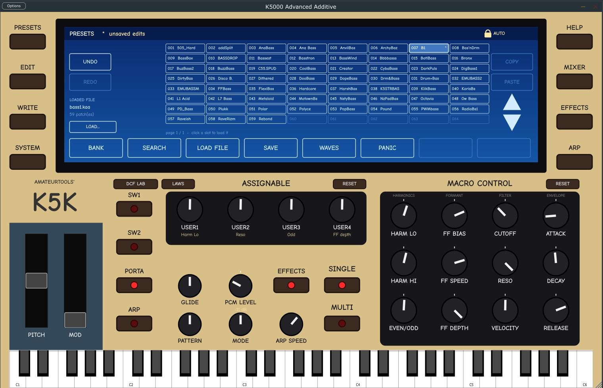
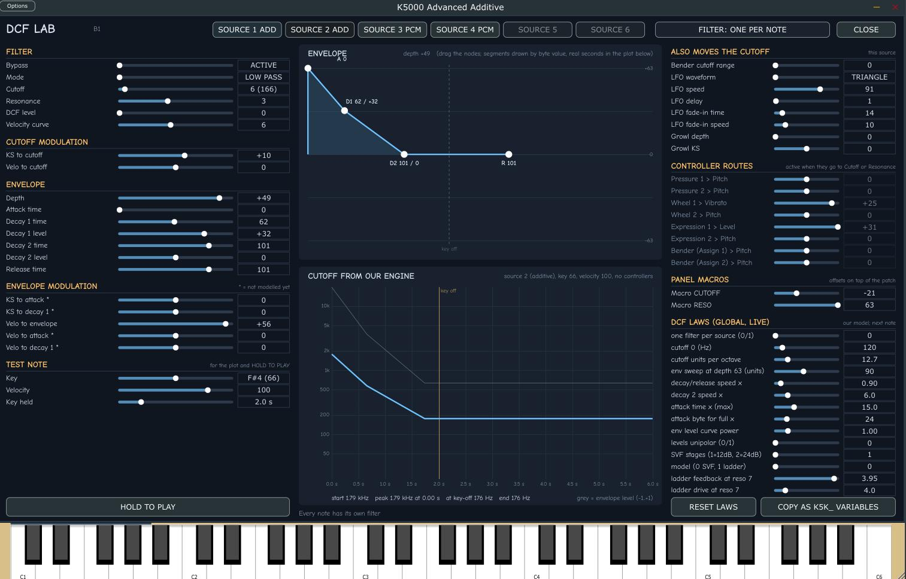
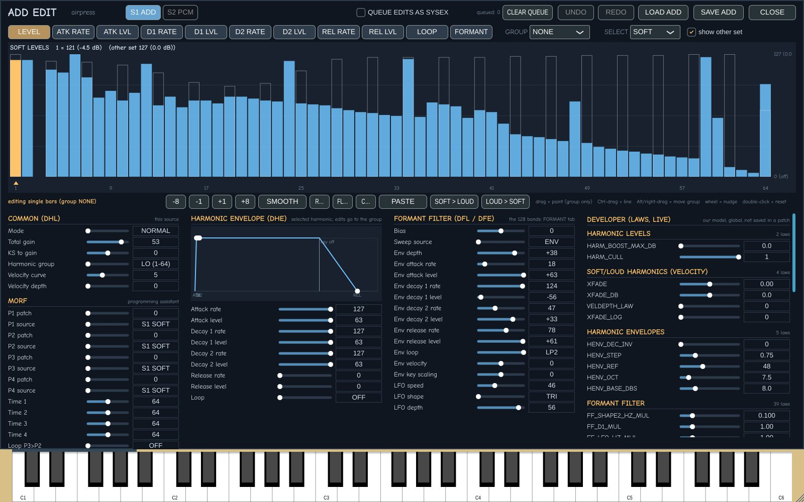

Goals: 

:x:create a plugin/standalone

for all platforms

Sounds close to the original.

:x:does not require roms or copyrighted things.

create a usable GUI for this synth for the first time ever.

:x:loads and exports presets and banks.

:x:sends sysex for programming a real Kawai K5000.

move all the research stuff into a github folder called RESEARCH

upload the working code that I already have, but didn't get around to it yet.

:x:current sound demo, needs a lot of work so don't get too excited yet:

https://soundcloud.com/amateurtoolsdsp/amateurtools_k5000_hle_week2_p

:x:development stage gui stuff:

